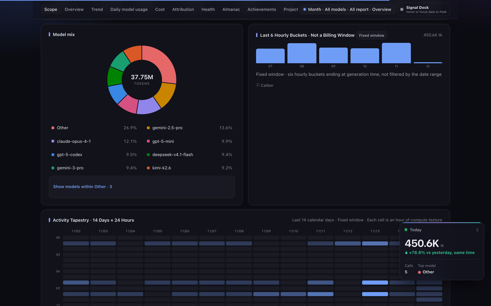

<div align="center">
  

# tokens

**看清 AI 编程 Token 去向，同时不把本地日志上传到任何地方。**

把本机 Claude Code、Gemini CLI、Codex、OpenCode 与 Antigravity 记录变成终端摘要、仅限回环地址的实时 Dashboard，或一个自包含离线 HTML 文件。

[](https://lingxi-fur.github.io/tokens/demo/)
[](https://github.com/LingXi-fur/tokens/actions/workflows/ci.yml)
[](https://github.com/LingXi-fur/tokens/blob/main/pyproject.toml)
[](https://github.com/LingXi-fur/tokens/blob/main/LICENSE)
[](#隐私边界)

[体验交互 Demo](https://lingxi-fur.github.io/tokens/demo/) · [克隆并运行](#克隆并运行) · [在线文档](https://lingxi-fur.github.io/tokens/zh/) · [Dashboard 指南](https://lingxi-fur.github.io/tokens/zh/dashboard.html) · [English](https://github.com/LingXi-fur/tokens/blob/main/README.md)

**用自己的数据前先看看：**在浏览器打开[合成 Dashboard](https://lingxi-fur.github.io/tokens/demo/)，无需安装、账户或本地日志。在线页面可交互，但不会实时读取你的电脑；克隆后可用 `./run demo --open` 在本机体验。

</div>

[](https://lingxi-fur.github.io/tokens/demo/)

> 预览由真实 Dashboard 使用虚构记录生成，不含真实本地日志、私有路径、会话标识或路由配置。

## 不用自己的日志也能体验

打开[交互式合成 Demo](https://lingxi-fur.github.io/tokens/demo/)，用虚构记录体验 Dashboard。在线 Demo 不会读取本机数据，也不实时刷新本机日志；克隆后运行 `./run demo --open` 可生成同类本地示例报告。

## 为什么值得用？

AI 编程工具在本机留下用量记录，但格式和 Token 口径不同。`tokens` 提供可检查的本地视图：

- **在同一份报告中查看 Claude Code、Gemini CLI、Codex、OpenCode 与 Antigravity**（默认按 `--source auto` 自动发现可读来源），同时保留各来源的计数语义。
- **找到值得继续查看的变化：**日 / 周 / 月趋势、两个时段的对比（主力模型易主时亮出换人徽章）与用量峰值。还可复制当前视图摘要（有可比窗口时包含环比），粘贴到笔记或消息里。
- **追溯用量去向：**通过项目 / 模型概览与会话卡，在来源字段允许时查看模型、来源、项目和会话的用量构成。
- **查看订阅额度窗口：**运行 `tokens quota` 查看 Codex 官方额度快照与 Claude 容量估算及预计撞线时间，全程本地读取、不上传日志。
- **默认暗色界面与今日浮窗：**默认暗色配柔和浅色主题，仅导航条与浮层等外壳使用半透明玻璃；附带配速赛道、模型份额流与活动日历等概览洞察，以及可拖动、可折叠的 Today HUD 今日浮窗。
- **掌握输出：**精确表格、CSV / Markdown、本机实时刷新和自包含的离线 HTML 快照。

本地 CLI 与 Dashboard 无需账户、遥测端点、托管后端或外部运行资源；AI 编程工具和本站有各自的网络政策。核心解析、聚合、报告和回环服务使用 Python 标准库。Windows 另需纯数据包 `tzdata` 才能稳定使用 IANA 时区。

## 克隆并运行

要求：macOS、Linux 或 Windows 上的 Python 3.9+。分析自己的用量还需要受支持 AI 编程 CLI 已生成的本地日志；合成 Demo 不需要日志。

```bash
git clone https://github.com/LingXi-fur/tokens.git
cd tokens
./run doctor
./run serve --open
```

不传 `--source`（即 `--source auto`）时，程序会检查 `sources.py` 注册表内五个来源（Claude Code、Gemini CLI、Codex、OpenCode、Antigravity）的路径与可读权限，自动启用所有存在且可读的来源（只检查路径，不打开正文）。如需只扫描指定来源，可重复传入 `--source`（例如 `--source gemini`、`--source antigravity`，也可与 `auto` 组合）。

`./run doctor` 检查路径、候选文件数、时区、输出和缓存权限，不解析消息正文，也不打印项目或会话标识。

`./run doctor --models` 说明 Claude 用量是如何归属到模型的。它通过常规的缓存读取入口拿到记录，按“日志中的请求名 → 解析后的归属名”分组，并标注每组的归属依据：`logged`（原样记录的后端名）、`hex_alias`（CCR 的 `anthropic/claude-ccr-h…` 别名解码为后端）、`native_direct`（直连 Anthropic 的请求保留原名并归一版本，例如 `claude-opus-5-5` → `claude-opus-5.5`）、`router_rule`（层级别名被当前路由规则改写）。报告会列出路由文件路径与当前规则，然后只显示记录数、token 合计和首次/最近日期，不显示 cwd、会话 ID 或项目名。可用 `--since`/`--until`（`YYYY-MM-DD`，按报告时区解释）缩小范围，例如只看今天；`--json` 输出机器可读结果。不带参数的 `./run doctor` 仍只做环境诊断，不读取日志内容。

### 订阅额度

`./run quota` 回答“这个窗口还剩多少、照现在速度几点会撞线”。它读取 Codex 官方 `rate_limits` 快照和 Claude 撞线事件。Codex 窗口按 `window_minutes` 识别（例如 300 或 10080），不按 `primary`/`secondary` 标签；不同 `limit_id`/`limit_name` 的额度分开计算。每个窗口显示最新使用百分比、按报告时区换算的重置时间、最近 60 分钟快照得到的速度，以及外推撞线时间；快照少于两个或跨度不足五分钟时明确显示“数据不足”。已经重置的窗口会标记为已重置，不再展示旧百分比。

Claude 没有官方百分比，因此该区块明确标注为估算。对每个带重置时间的撞线事件，把 `[重置 − 5h, 撞线时刻]` 内的直连 token 作为一个容量样本；只统计 Anthropic 直连记录（模型以 `claude-` 开头，且请求名归一后等于该模型），经 CCR 路由到 GLM/DeepSeek 等后端的 token 不计入。已经结束且没有撞线事件的 5 小时窗口还会提供容量下限：容量取 `max(撞线样本中位数, 最高安全窗口)`；若安全窗口高于所有撞线样本，报告会说明撞线样本已过时。报告输出中位数、最小/最大值和样本数，再用最新 5 小时分段中的第一条直连记录推断当前窗口。窗口边界是近似值，且不按模型消耗权重加权。OpenCode 没有额度信号，会明确显示无官方额度数据。

`--source codex`（可重复）限定来源，`--json` 输出机器可读结果，`--no-cache` 忽略本地缓存目录下独立的 `quota-v1.json` 扫描缓存。只使用时间戳、额度字段、模型名和 token 合计；不打印消息正文、cwd、会话 ID 或项目名。首次运行需要扫描全部本地日志，可能较慢；后续运行会复用额度扫描缓存与读取器缓存。
看板右下角的“今日”浮窗会显示同样的窗口——Codex 官方快照与 Claude 估算——包括已用百分比细条、重置时间和预计用完时间，时间按报告时区显示；`tokens serve` 每次实时快照都会刷新，静态看板则保留生成时的快照。

### Token 投入产出

`./run outcomes` 回答的是与 `quota` 不同的问题——不是“还剩多少”，而是“花费换来了什么”。它按天、项目、模型、工具统计提交数、新增/删除行数、7 天后仍保留的行数、返工税、每 $1 留存行数与每提交成本。`--since`/`--until`（`YYYY-MM-DD`，闭区间，按报告时区）限定范围：只给 `--since` 时统计到今天为止；只给 `--until` 时从记录最早一天开始；完全不传时覆盖记录自身的日期跨度。`--json` 输出机器可读结果。

每个会话的工作目录被对应到其 git 仓库——同一仓库的多个 worktree 合并计算——本人的提交（git config `user.email`/`user.name`，可用 `TOKENS_OUTCOME_EMAILS` 追加）按时间归到对应会话：从会话开始到最后活动后 30 分钟内；落入多个窗口的提交归入活动结束时间最接近的一个，merge 提交不统计，落在所有会话之外的提交计为手工提交。**留存行**指提交 7 天后仍存在于 HEAD 的行，用只读 `git blame` 测量，按仓库和提交缓存在本地缓存目录（`outcomes-blame-v1.json`，HEAD 变化后失效）。不满 7 天的提交标记为**待定**：新增行照常统计，但留存报告为未知，而不是 0。**返工税**是会话新增的行在 7 天内被删掉的比例乘以该会话花费。金额使用与费用账本相同的官方 USD 参考价——没有官方价的记录贡献 token 但不计金额，报告会说明金额只覆盖可估价部分。锁文件、`package-lock.json`、`dist/`、`node_modules/`、`*.min.js` 不计入测量；`TOKENS_OUTCOME_EXCLUDE` 可追加排除模式。

不在任何 git 仓库中的会话（连同其花费）单独列出（没有工作目录的会话也计入此类），仓库里没有产生提交的会话也单独列出。区块带状态：全部测量完成时为 `ok`；仓库不可读、文件 blame 超过 10 秒失败、或单次构建 400 个提交的 blame 预算用尽时为 `partial`（`reasons` 标明失败的检查，如 `repo_unavailable`、`blame_timeout`、`blame_skipped`）；缺少 git 时为 `unavailable`——此时仍报告会话花费。其他原因计数包括 `no_repo`（不在任何 git 仓库的会话）、`bad_session_ts`（时间戳无法解析的记录被跳过）、`blame_cache_reset`（磁盘上的 blame 缓存损坏或版本不符，已重建）、`binary_commit`（涉及二进制文件的提交，numstat 不提供行数）和 `unestimated_cost`（没有官方参考价的记录）。

按模型/按工具的价值表复用同一批已测提交，但绝不把整个会话算给“主力模型”。花费按 `(工具, 模型)` 桶精确拆分；提交、新增行、已定案留存行、待定行与返工税按该模型/工具在会话花费中的占比分摊，因此一个会话用了几个模型，就会在几行里各占一份比例；只有会话内所有可估价金额都为 0 时，才改用 token 数作为权重。少于 3 个会话或已定案花费低于 $1 的行标记为**样本少**，不参与排名（终端把这类行排在排名之后并加 `*`）。不属于任何会话的手工提交无法归到模型或工具，两张表都不计入。工作目录已被删除的会话仍可通过 OpenCode 的本地项目映射（含已删除的 worktree）找回仓库。

隐私口径不变：outcomes 块只含计数、比率和标签——绝不含提交信息、文件名或作者邮箱——项目名遵循 `--anonymize`。git 只被读取，每次调用都有超时上限。

示例（项目路径已替换为占位符）：

```text
投入产出（2026-10-20 ~ 2026-11-05）
状态：正常

会话花费: $1,833.10  ·  提交: 6  ·  无会话提交: 0  ·  无提交会话: 3
不在 git 仓库的会话: 30  ·  会话花费: $1,688.02
新增/删除行: 6,948 / 290  ·  留存行: 6,804
返工税: $0.77  ·  每 $1 留存行: 3.7  ·  每 $1 留存行（仅满 7 天）: 155.1  ·  每提交成本: $305.52

项目                                       仓库       提交         留存           花费        返工税
/path/to/home                             否        0          0      $288.23      $0.00
/path/to/project-a                        否        0          0        $4.18      $0.00
/path/to/project-b                        否        0          0        $6.37      $0.00
/path/to/repo-a                           是        3      2,196       $11.75      $0.62
/path/to/repo-b                           是        0          0       $45.56      $0.00
/path/to/project-c                        否        0          0    $1,303.64      $0.00
/path/to/project-d                        否        0          0       $20.54      $0.00
/path/to/project-e                        否        0          0       $58.47      $0.00
/path/to/project-f                        否        0          0        $6.60      $0.00
/path/to/repo-c                           是        3      4,608       $87.75      $0.15
```

实时 Dashboard 只绑定 `127.0.0.1`。后台默认每 5 分钟检查日志（`--interval`）；页面请求直接读取最近成功的内存快照，不等待扫描。浏览器默认至多每分钟检查已发布更新，首次准备期间采用更短间隔。页面的 1、5、15、30 分钟及暂停选项只控制浏览器检查，不改变后台扫描。首次准备明确显示等待状态；后续扫描失败保留旧数据，并显示最近成功检查时间。文件未变化时不重新解析。

浏览器优先读取轻量 `/api/status`，仅在需要时获取完整 `/api/snapshot`；不支持状态接口的旧服务继续使用快照条件请求。扫描详情显示文件发现、记录采集、数据构建、编码阶段，以及耗时、成功处理文件、已发现候选、缓存命中、实际解析和跳过数量。“已发现”是截至当前的累计数，不是预先知道的总量：这些数字**不是完成百分比或预计剩余时间**。单个大文件可能长时间不更新计数。页面暂停、隐藏或断连时保留上次收到的状态，不编造服务心跳。耗时用于诊断，不代表已经提速。

**接入状态：**读取器层已实现内存复用，但 `serve` 尚未接入；下段描述待完成的服务接入，不代表运行中服务已启用。

启用缓存的非匿名 `serve` 还会在当前进程内有界保留已成功处理的 Claude/Codex 文件解析结果。后续文件失败时，重试可复用此前未变化的文件，但仍安全重新打开，并重新执行跨文件冲突与整轮限额检查。失败文件继续重试，不会跳过，也不发布部分报告或部分磁盘缓存。“缓存命中”包含磁盘缓存与进程内复用。内存复用最多保留 4096 个文件、100000 条记录、64MiB 估算保留量（不是进程 RSS 上限），单文件最多 8MiB / 20000 条记录；超大项不保留。重启即清空，文件或配置变化使复用失效；无法可靠识别的 parser/时区环境不启用。输出记录含无明确 UTC 偏移时间戳的文件也不进入进程内复用，仍按原规则解析。顺序扫描的工作集超过容量时，LRU 淘汰可能使下一轮仍零命中；这些上限不保证提速。`--no-cache` 和匿名模式禁用此复用。它可减少失败后的重复解析，不缩短首次冷扫描，也不解决冲突本身。

启用缓存的非匿名 `serve` 可在本机缓存目录的 `live-snapshot/last.json` 保留一份成功 Dashboard 快照（macOS 缓存目录为 `~/Library/Caches/ai-cli-tokens`）。重启后先展示兼容的旧快照，保留原始时间、标明“已恢复”，同时执行完整扫描重新验证；失败或部分扫描绝不覆盖旧快照。文件保存 Dashboard 聚合数据，包含报告原有的项目/会话标签及标题，不是原始对话日志，但仍可能含私人信息。数据仅留本机，使用 POSIX 私有目录 0700、文件 0600，不新增上传。完整性哈希用于发现损坏，不能认证同一用户权限下其他进程的恶意修改；这不是同用户进程间的安全隔离。`--no-cache` 同时禁用记录缓存和快照缓存读写；匿名模式、缺少等价 ACL 校验的 Windows、无法稳定辨识时区的环境不持久化或恢复。损坏、不安全或不兼容文件视为未命中；写入失败仍保留有效内存数据并显示存储警告。恢复必须以此前完整成功为前提，不能把首次采集失败（包括 Codex 用量冲突）变成有效数据。

还没有本地日志？可先打开由同一报告管线生成的完整合成 Dashboard：

```bash
./run demo --open
```

Demo 只使用生成的示例数据写入 `out/dashboard-demo.html`，不会读取本机 Claude Code、Gemini CLI、Codex、OpenCode 或 Antigravity 日志。

需要离线归档时：

```bash
./run dashboard --open
```

### Windows 源码检出

先在本地虚拟环境中安装源码检出；这也会安装必需的 `tzdata`：

```powershell
git clone https://github.com/LingXi-fur/tokens.git
cd tokens
python -m venv .venv
.\.venv\Scripts\Activate.ps1
python -m pip install -e .
tokens doctor
tokens serve --open
```

如需只限定特定工具，可在 `tokens serve --open` 后重复传入 `--source`。

### 可选：安装本地命令

在已克隆的源码目录中创建虚拟环境，并以 editable 方式安装：

```bash
python -m venv .venv
source .venv/bin/activate
python -m pip install -e .
tokens doctor
tokens serve --open
```

Windows PowerShell 激活命令为 `.venv\Scripts\Activate.ps1`。

这会从本地源码检出安装，不依赖任何已发布的软件包注册表版本。

### 本机 0.3.0 候选——不是公开发布

本检出中的 0.3.0 内容是**本机发布候选**，不是公开发布：不存在公开发布日期，也不声称 PyPI 已有 0.3.0。下面只是本地安装示例，**不证明候选已完成构建或测试**。候选构建、产物审查、纯净环境冒烟与基于候选产物安装的服务更新须先通过候选发布核对清单（本机检出的 `docs/release-candidate-checklist.md`）；对外发布需另行授权。对已测试源码检出服务另行授权的重启，不等于候选产物验收，也不将这些清单项标为完成。

如果你拿到的是已通过核验的本地候选 wheel，可离线安装（不访问索引、不解析依赖）：

```bash
python3 -m venv /tmp/tokens-030-venv
/tmp/tokens-030-venv/bin/python -m pip install --no-index --no-deps /绝对路径/ai_cli_tokens-0.3.0-py3-none-any.whl
/tmp/tokens-030-venv/bin/tokens --version
/tmp/tokens-030-venv/bin/tokens demo --output /tmp/tokens-030-demo --open
```

请把 wheel 路径替换为实际获批产物；上面的路径只是占位符，不是下载地址。请使用全新的输出目录（或自行选择其他全新路径）。`--no-deps` 特意跳过依赖安装。Windows 下请创建 venv 后使用其 `Scripts\python.exe` / `Scripts\tokens.exe`；`tzdata` 需已可用，或用同样的离线参数从已审查的本地 wheel 单独安装。缺少本地工具或依赖时应当视为阻塞，而不是转而联网下载。平台支持是产品目标，不代表本候选已在该平台通过核验。

也可以**直接运行获批的候选源码检出**，无需安装、不经过软件包注册表：

```bash
cd /绝对路径/获批候选源码
./run --version
./run demo --output /tmp/tokens-030-source-demo --open
# 可移植源码启动方式（仅对该命令设置 PYTHONPATH）：
PYTHONPATH=src python3 -m tokens_cli demo --output /tmp/tokens-030-source-demo --open
```

这一显式源码运行路径与核对清单中的 wheel 验证是分开的：wheel 验证会清空 `PYTHONPATH` 并确认 import 来自安装的 venv。月度预算规格（本机检出的 `docs/monthly-budget-design.md`）对应费用账本内的本地月度预算功能（仅在你保存预算时写入当前浏览器的 `tk-budget-v1`）。

## 选择输出方式

| 目标 | 源码检出命令 | 行为 |
|---|---|---|
| 快速看终端摘要 | `./run day` | 最近 14 天终端报告 |
| 安装前在线体验 | [打开在线合成 Demo](https://lingxi-fur.github.io/tokens/demo/) | 无需 clone、账号、本地日志或上传 |
| 本机无日志体验 | `./run demo --open` | 只用合成数据，写入 `dashboard-demo.html` |
| 长期开着 Dashboard | `./run serve --open` | 仅限回环地址的服务，页面内更新 |
| 保存离线归档 | `./run dashboard --open` | 自包含的生成时快照 |
| 准备更安全的分享副本 | `./run dashboard --anonymize --open` | 对选定标识做假名化 |

报告默认写入 `./out`；可用 `--output DIR` 更改位置。

## 能看出什么？

页面按**统计范围 → 用量总览 → 趋势与精确明细 → 每日模型用量 → 费用**组织。先选日期与模型，再看当前统计值；生成日回退规则和覆盖边界可在页头「快照说明」展开。

页头区分已启用来源与本快照实际读到的来源。数据体检列出各来源记录数、Token、记录日期和字段能力；「本快照未读到记录」不等于没有使用，「未启用」不等于本机没有日志。来源数量与日期按报告快照统计，不随前端模型筛选变化，最近记录日也不是同步时间。首次扫描失败不会用 0 冒充用量；后续更新失败会保留上次成功快照并提示。错误诊断仅包含受控阶段与原因码，不公开原始异常或路径。

找出用量最高的日子，对比两个等长时段，并查看哪些**已有记录**中的模型、项目或会话构成了差异。最多 8 个独立模型各占固定分类色（每个活跃来源保底 1 个槽位），而 `Other` 改用中性灰并拆开逐个列出：Model mix 图例、趋势图例、环形图切片、趋势悬停、期间明细表展开（`Other (N)`）、导出与“更多模型”筛选都会直接列出具体模型及其来源与精确 Token；Today HUD 的主力模型永远显示真实模型名，脱敏报告不含被折叠原名。在来源确实提供相应字段时，你可以：

- **发现变化：**查看日 / 周 / 月趋势、峰值时段与 Token 构成。
- **追溯记录：**按来源和模型筛选，查看项目与会话聚合；非脱敏 Dashboard 还可查看归入 Other 的原始模型名。
- **核对数字：**从图表切换到精确表格，导出 CSV / Markdown，或保存自包含离线 HTML 快照。

交互方法、双时段透镜、峰值剖面、成就中心等见[中文 Dashboard 指南](https://lingxi-fur.github.io/tokens/zh/dashboard.html)。A/B 只比较记录中的 Token 构成，不能证明用量变化的原因；基线为零时只报告绝对 Token 变化。项目和会话是平行聚合，不会自动配对。选定的 A/B 周期及打开的峰值剖面可能从 URL 恢复；项目 / 会话 ID 与精确 Token 明细不会写入 URL。

Token 增减只描述用量变化，不代表生产力或代码质量。Cache Read 是缓存 Token 读取量，不是已确认的货币节省。

### 本地费用估算

**费用账本**使用独立记录的计费分量，内置 2026-11-15 对照各官网核对的官方**参考价**（涵盖 Google Gemini、OpenAI、Anthropic、DeepSeek、Z.ai、Moonshot），也可在**设置单价**中填写你自己的价格。官网未公布的分量留空不推算，内部或已下线的模型名保持未定价。默认没有本地配置时，账本优先显示 USD 参考价估算，且在你保存前不会写入浏览器存储。

- **内置参考价**为 2026-11-15 对照各厂商定价页核对的官方 USD 单价（每百万 Token）：Google Gemini Standard 付费档，2026-11-19 复核（`gemini-4-neon`、`gemini-4-hydrogen`、`gemini-2.5-pro` ≤200K 档、`gemini-2.5-flash`、`gemini-3-flash-preview`，思考 token 按输出价，官网未公布的缓存写留空不做推算；定价页未列出的型号名如 `gemini-3-pro-preview` 保持未定价）、OpenAI Standard 短上下文档（≤272K，含 `gpt-5.3-codex`）、Anthropic Claude 全系（含 `claude-fable-5-1`，缓存写取 5 分钟档）、DeepSeek 峰时基准、Z.ai 国际美元价，2026-11-19 复核（GLM-5.3、GLM-5.3-Flash、GLM-5.3-FlashX、GLM-5.2、GLM-5.1、GLM-5；并非国内智谱同价，缓存存储限时免费记为 0，思考内容按输出价计；直写 `zhipu/` 前缀的记录按同后端单独入表）、Moonshot Kimi。页面不会主动向供应商请求这些价格，公开参考价随页面资产嵌入；供应商来源链接只在你主动点击时打开。
- **手填单价**按日志来源与原始模型分别保存，归入 Other 的模型也分别定价，并对该条目整体优先于内置参考价。日志来源不是供应商或计费渠道；模型名可能经过路由别名映射，不保证等同实际计费 SKU。明确填写 0 代表免费，空白仍为待定价。清空全部价格并保存会以此全空覆盖防止参考价回填；CNY 永不套用 USD 参考价。Gemini thoughts 单独计价。
- **设置单价**新增**使用官方参考价 USD**开关。当前币种为 CNY 且已填价格时，开启会先请求确认，并一次性执行：清空你的自定义条目（含备注）并切换到 USD。不假设汇率、不换算已填条目；取消则保留原价格与币种。在此开关出现前保存的旧有效配置没有 reference 标记，会保留原币种与手填值，并保持参考价关闭。
- **恢复官方参考**在单价编辑器内按单个模型操作。仅当草稿为 USD 且参考层开启、模型未隐藏、精确模型名命中内置参考、且该来源/模型存在已保存覆盖（全空、显式 0、仅备注都算覆盖）时显示。确认只清除该条目的单价与备注，其他模型不变；取消不做任何修改，不保存退出不落盘。恢复后再次输入价格仍会创建普通覆盖。
- **导出 CSV** 仅在你点击按钮时在本地下载当前费用账本：不 fetch、不新增端点、不点击不导出。内容跟随当前粒度、选区、模型筛选、币种与有效价，导出全部条目、不受分页限制。行内包含行类型、范围、source/模型、币种、定价状态、五分量 Token/有效单价与估算金额，绝不包含会话、标题、项目路径或备注。参考价/手填已定价、待定价、隐藏状态分明；未知留空、显式 0 表示免费。金额来自定标整数费用管线的精确十进制结果，不做展示层舍入。汇总记录携带未知调用/Token、非法行、totalIncomplete、已定价小计与 fullEstimate 标记；无可计价金额时留空，不伪造完整总额。单元格对分隔符与危险公式前缀做了转义。
- 账本跟随模型筛选、统计粒度与选定周期。只有整个选定范围都能可靠计价时，才显示**估算总费用**；否则显示**已定价小计**和待定价／口径待确认覆盖，不猜测未知分量。日志 Token 总量异常或无法安全表示时，不显示 Token 覆盖率，仍保留调用覆盖。
- 费用是所选范围内统一的参考价／手填价估算，不是渠道实际扣费。记录只有日级粒度，账本无法识别每次上下文或特定时段的折扣，也不把订阅套餐、缓存存储等成本折算为花费。合并缓存写入单价须由你确认其有效性，不会自动区分 5 分钟／1 小时价格档。
- 一次使用一种货币（CNY 或 USD）；换币须清空并重填单价，不假设汇率。
- 价格配置仍仅保存在当前浏览器原有的 `tk-cost-v1` 本地存储中，不调用供应商、不需要 API 密钥，也不新增存储键；读取器与用量统计不变。私人手填价不嵌入报告。实时页面与离线文件的存储作用域可能不同；存储失败时仅当前页面有效。

缺少计费数据的旧离线快照需要重新生成。当前记录缓存文件为 `records-v8.json`，其内部 schema 版本（当前 22）覆盖 Codex 事件身份、修正后的输出口径、已接受的零用量和有界上下文估算更新、混合格式并集计数契约、作为新账本基线处理的累计重算、重复累计锚点的无条件首见证据保留（跨模型边界也如此，换模型 resume 后的同锚点消费归入首见模型）、Claude 记录在路由解析后的后端名旁保留原始请求模型名这一信息性字段（不改变计数、去重或费用归账口径），以及直连 Anthropic 请求保留原始模型归属而不被当前 CCR 路由规则追溯改写；旧缓存文件保留。

## 支持的数据源

| 来源 | 默认本地路径 | 项目数据 | 会话数据 | 计数说明 |
|---|---|---:|---:|---|
| Claude Code | `~/.claude/projects/**/*.jsonl` | 有 | 有 | 总量为 input + output + cache read + cache write。 |
| Gemini CLI | `~/.gemini/tmp/*/chats/session-*.json` | 通常无 | 有 | 有来源 `tokens.total` 时优先使用。 |
| Codex | `~/.codex/{sessions,archived_sessions}/**/rollout-*.jsonl[.zst]` | 通常无 | 通常无 | cached input 已包含在 input 中，reasoning 已包含在 output 中，均不重复相加；压缩归档需要本机已有 `zstd` 可执行文件。 |
| OpenCode | `~/.local/share/opencode/opencode.db`（SQLite，遵循 `XDG_DATA_HOME`） | 有 | 有 | 总量为 input + output + reasoning + cache read + cache write；OpenCode 的 input 不含缓存、output 不含 reasoning。只读打开，只查询 token、模型与时间字段，从不读取消息正文。 |
| Antigravity | `~/.gemini/antigravity/conversations/*.db`（SQLite，可通过 `TOKENS_ANTIGRAVITY_DIR` 覆盖） | 无 | 有 | 总量为 input + output + cache read。只读打开，只取 token、模型与时间字段，从不读取对话正文或摘要库。基于未公开的私有格式，应用升级后可能需要同步更新读取器。 |

默认按 `--source auto` 自动启用 `sources.py` 注册表内所有存在且可读的来源；可重复传入 `--source` 限定或组合指定来源（例如 `--source antigravity`）：

Codex 的 `.jsonl.zst` 压缩归档要求采集进程能通过 `PATH` 找到 `zstd`；普通日志不需要此依赖。后台服务与交互终端的环境可能不同，`./run doctor --source codex` 仅反映运行该命令的进程环境，不代表常驻服务。出现 `collection · codex · decompressor_unavailable` 时应检查服务环境，不要跳过压缩归档；修改服务配置后须重新加载其环境才会生效。启用来源不等于已有用量，仍须核对成功快照及来源实际记录。

`collection · codex · usage_conflict` 是用量完整性冲突，不是缺少解压器。可能涉及同一响应或累计锚点的证据不一致，或活动日志与归档间重复身份的内容冲突。仅凭公开错误码不能区分具体检查，也不能证明生产者存在缺陷。新版实时 Dashboard/API 可额外返回下表中的固定 `error_details.conflict_kind`；旧服务及缺少子码的错误继续显示通用诊断。子码只标明哪项检查失败，不说明究竟哪个字段或哪份副本正确；CLI 错误仍为通用提示。

| `conflict_kind` | 触发的检查 |
| --- | --- |
| `modern_response_mismatch` | 同文件内同一现代响应身份的用量、模型或计费证据不一致。 |
| `legacy_cumulative_rollback` | 为兼容保留的错误码，但不再触发：旧格式累计 `total_tokens` 下降转为新账本基线，不再失败。 |
| `legacy_anchor_mismatch` | 为兼容保留的错误码，但同文件内不再触发：重复旧累计锚点一律保留首见证据，跨模型边界也如此。 |
| `cross_file_identity_mismatch` | 跨文件同一重复用量身份的用量、模型或计费证据不一致，不限于现代响应。 |

仅在 `legacy_anchor_mismatch` 时，`error_details.mismatch_kind` 可进一步标明差异组别：`usage`、`model`、`billing`、`usage_model`、`usage_billing`、`model_billing` 或 `usage_model_billing`。usage 指既有六字段用量签名；billing 还区分字段缺失与显式零。页面只显示固定组名，不显示比较值、模型名、路径或会话标识；缺少或非法细节仍使用原累计锚点通用解释。差异组别不证明根因、不选择正确副本，也不代表统计已恢复。

两种窄状态更新可接受，但不新增消费记录。共同前提是同会话、同模型的相邻旧格式事件，累计各标准字段完整且未变，并且该锚点原记录是可信正用量。新单次用量的各分量须显式为整数零，总量则须为可信零，或为严格小于原单次总量且不超过累计总量的正值、计费不确定原因仅有 `total_mismatch`。Codex 可以保留累计消费、把单次用量换成上下文估算；估算不是新增消费，原记录及计费证据保持不变。该形状不认证生产来源，也不证明本机冲突根因。首次独立的仅 total 记录不会被过滤；证据不完整、其他计费不确定、模型变化、相邻性破坏或随后不同消费仍执行原校验。

现代记录不再打断这些更新所依赖的旧格式相邻性证据。旧格式 `token_count` 事件是账本基线：真实生产日志对现代格式的持久化只是部分且乱序的，两侧单独都不完整。混合格式文件因此按两种格式的并集计数：每条旧格式消费计一次；现代记录若其（用量、模型、完整计费）值与未使用的旧格式条目完全相同，作为镜像被吸收、不重复计数。超出该多重集交集的现代记录作为独立消费并入账本——真实生产日志对不完整响应只写现代格式。由于旧格式事件没有 response ID，该值匹配无法证明某条现代记录镜像特定的旧格式条目：若另一笔真实消费与某条旧格式条目同值，会被并入其中而少计。该少计方向在本契约下是结构性的；不保证任意混合日志无损合并，校验通过也不代表本机统计已经恢复。

采集会停止，不发布部分总量；已有成功快照继续保留。请保留原日志和缓存，不要靠删除归档、任意挑选副本或放宽校验获得总数。`doctor` 不解析用量事件，不能解决此冲突；应使用合成复现，或在明确授权下检查去标识化证据，不上传对话日志。

```bash
./run serve \
  --source claude \
  --source gemini \
  --source codex \
  --source opencode \
  --source antigravity \
  --open
```

各工具公开的 Token 语义并不完全相同。`tokens` 保留各来源报告的总量，不伪装成绝对同口径。

复用 Claude Code 本地日志的 Claude App Code 会话只通过既有的 Claude 来源计入一次，不会有第二个 App 来源。普通 Claude 聊天与 Cowork 的 token 用量未接入：其 token 总量未知，而不是零。订阅用量采样不会换算成 token。本地报告不代表已覆盖其他设备、云端会话或整个账号。

Codex 采集同时支持旧格式 `token_count` 与新格式 `token_usage_record` 事件。稳定的事件身份防止活动日志与归档中的重复副本抬高总量；两种格式之间完全镜像的记录只计一次。混合格式歧义、身份冲突、文件不可读、归档解压器不可用或触发资源限额时，按采集不完整报告，不会发布部分成功的结果。

## CLI 要点

```text
./run [day|week|month|all|dashboard|demo|serve|doctor|quota] [options]
tokens [day|week|month|all|dashboard|demo|serve|doctor|quota] [options]  # 本地安装后
```

| 参数 | 用途 |
|---|---|
| `--source antigravity\|claude\|codex\|gemini\|opencode\|auto` | 选择来源（默认 `auto` 自动启用所有可读来源），可重复组合。 |
| `--since YYYY-MM-DD` / `--until YYYY-MM-DD` | 限制闭区间日期范围。 |
| `--days N` / `--weeks N` / `--months N` | 限制 `day`、`week` 或 `month` 终端模式显示的期数。 |
| `--timezone AREA/CITY` | 覆盖检测到的系统时区。 |
| `--lang en\|zh` | 终端及静态 HTML 语言；默认跟随系统 locale（可由 `TOKENS_LANG` 覆盖）。 |
| `--output DIR` | 指定报告目录，默认 `./out`。 |
| `--html` | 为终端模式额外生成静态 HTML。 |
| `--dashboard` | 无论位置参数为何，生成交互式离线 Dashboard。 |
| `--anonymize` | 在 Dashboard 或实时模式中假名化标识。 |
| `--models` | 与 `doctor` 联用，展示模型归属报告（含 OpenCode）。 |
| `--json` | 与 `doctor --models` 或 `quota` 联用，输出机器可读 JSON。 |
| `--interval SECONDS` | 设置后台日志扫描间隔；最小 1，默认 300。浏览器检查频率独立。 |
| `--port PORT` | 设置回环端口；默认 8765，0 表示自动选择。 |
| `--open` | 用默认浏览器打开生成文件或本机 URL。 |
| `--no-cache` | 重新读取所有选中的日志文件。 |
| `--version` | 显示程序版本号并退出。 |

完整说明见[中文 CLI 文档](https://lingxi-fur.github.io/tokens/zh/cli.html)。

## 隐私边界

`tokens` 在本机读取和分析文件。离线快照不发起网络请求；实时模式只与同源的 `127.0.0.1` 服务通信，并且没有局域网绑定选项。可选的 `~/.claude-code-router/custom-router.js` 仅在本机按文本读取，不执行、不上传；Router 规则只用于解释普通 Claude 请求别名，不会改写 Gemini 或 Codex 模型名。Claude 记录额外保留解析前的原始请求模型名作为信息性字段；请求名可能透露本机路由意图，匿名化导出不包含该字段。每日模型用量区提供"路由星图"折叠面板，用 SVG 流向图展示请求名到解析后端名的 Token 流（线宽按 token 比例，悬停高亮，点击后端名筛选），无别名数据或匿名化导出时整块隐藏。

记录缓存通过缓存目录内的临时文件写入，再原子替换；`os.fchmod` 可用时按文件描述符设置权限，POSIX 使用 `0600`。Windows 权限位不等同于 POSIX 访问控制，这不构成“仅当前用户可访问”的 Windows ACL 保证。请把缓存目录放在访问权限合适的位置。

普通 Dashboard 仍可能包含：

- 项目路径和工作目录
- 会话标识与本地派生标题
- 精确日期、模型、Token 数值和逐轮 Token 序列
- 可能识别个人或组织的行为模式

`--anonymize` 会将项目路径、会话标识与自然语言标题替换为报告内别名，但仍保留精确日期、保留独立身份的模型名、Token、关系和逐轮回放。非脱敏 Dashboard 还会显示归入图表 Other 色槽的原始模型名和精确用量；脱敏导出不包含这些被折叠的原名。经 Router 解析出的 backend 名也可能透露本地路由配置。因此它是**假名化，不是保证匿名**。

分享报告前：

1. 使用 `./run dashboard --anonymize`，确认分享的是 `dashboard-anonymized.html`，不是旧的普通 `dashboard.html`
2. 限制日期范围
3. 检查生成文件及其内嵌数据，也检查将要分享的截图、导出内容和视图 URL
4. 搜索用户名、客户名、仓库名和自定义模型标签
5. 不要向公开 Issue 附加原始日志

详见[数据与隐私文档](https://lingxi-fur.github.io/tokens/zh/data-and-privacy.html)。

## 当前边界

- 当前公共安装入口是源码检出；在确认存在可用发布版本前，不宣传软件包注册表安装命令。0.3.0 本机候选不改变这一点：它仅离线本机使用，不声称存在已核实的公开 0.3.0 软件包注册表版本。
- 不传 `--source`（默认 `auto`）时只检查目录/文件存在性与可读权限，自动启用五个已登记来源（Claude Code、Gemini CLI、Codex、OpenCode、Antigravity）中可读的来源；也可显式 `--source` 限定。
- Claude 和 Codex JSONL 文件不再仅因超过 64 MiB 被整份跳过。超长物理行（包括超过 4 MiB 的行）使用有界流式 JSON 校验与用量投影；仍有深度、词法 token、保留数据及数值词元等工程限制，不代表内存无限或历史日志绝对完整。
- Claude 和 Codex 采集不完整时，不把部分报告发布为成功结果；实时扫描保留最近成功快照，首次扫描失败则没有快照。Gemini、OpenCode 或 Antigravity 的单个文件读取或解析失败时，数据健康区会按来源显示跳过的文件数和原因，并在下次扫描时重试而不缓存失败结果。记录缓存 v8（`records-v8.json`）会重建不兼容的旧条目，不删除旧缓存文件。
- Windows 缓存设置会处理 `os.fchmod` 缺失，跨 API 安全读取在平台支持时比较创建时间（birth time），macOS 与 Linux 保持完整 `ctime` 校验；Windows 上 Codex 的 `.zst` 归档通过写线程流式解压。跨平台 CI（Windows、macOS、Linux）与跨浏览器运行时测试（Chromium、Firefox、WebKit）均通过。
- 来源格式提供的字段不同，部分项目、会话或 Context 视图可能不可用。
- 终端和静态报告支持 `--lang en|zh`，默认跟随系统 locale；交互式 Dashboard 可在页面内切换语言。
- 离线 Dashboard 是生成时快照。需要持续更新时使用 `./run serve --open`。

## 故障排查

**没有找到日志？** 运行 `./run doctor` 查看自动发现和跳过的来源；若只需查看单个工具，可试 `./run day --source gemini` 或 `./run day --source antigravity`。完全没有本地日志时可运行 `./run demo --open`；已安装本地命令则使用 `tokens demo --open`。

**Dashboard 数字不更新？** `./run dashboard` 生成离线快照；实时更新请使用 `./run serve --open`。

**采集不完整，或总量看起来偏低？** 先检查日志可读性及采集限制，再重试。刷新失败不代表零用量：实时页面可能仍显示较早的成功快照。`--no-cache` 仅绕过记录缓存，不取消安全限制。不要靠删除日志或旧缓存强行获得成功结果，也不要把原始日志附到公开 Issue。合成回归验证的是解析行为，不证明真实历史漏量已恢复；更新源码也不会自动重启运行中的服务。

**浏览器没有自动打开？** 命令仍会打印生成路径或本机 URL，可手动打开。

更多答案见[中文 FAQ](https://lingxi-fur.github.io/tokens/zh/faq.html)。

## 开发

Node.js 22+ 仅用于开发检查；运行 CLI 或 Dashboard 不需要 Node.js。

```bash
python -m pip install -e .
python -m unittest discover -s tests -v
python -m compileall -q src tests
node --check src/tokens_cli/dashboard_assets/dashboard.js
node --check docs/assets/site.js
```

测试覆盖读取器、缓存失效、打包、CLI 校验、假名化、Dashboard 合同、文档链接、无障碍、隐私断言和回环实时更新。

## 贡献与安全

欢迎真实的 bug 报告和聚焦的 Pull Request。请先阅读 [CONTRIBUTING.md](https://github.com/LingXi-fur/tokens/blob/main/CONTRIBUTING.md)，复现时只使用合成数据。

安全或隐私问题请按 [SECURITY.md](https://github.com/LingXi-fur/tokens/blob/main/SECURITY.md) 私下报告，不要创建包含真实日志或未经检查 Dashboard 的公开 Issue。

如果 `tokens` 对你有帮助，可以点一颗 star，让更多需要本地优先 Token 分析的人发现它；真实的平台反馈和 bug 报告更有价值。

## License

[MIT](https://github.com/LingXi-fur/tokens/blob/main/LICENSE)
